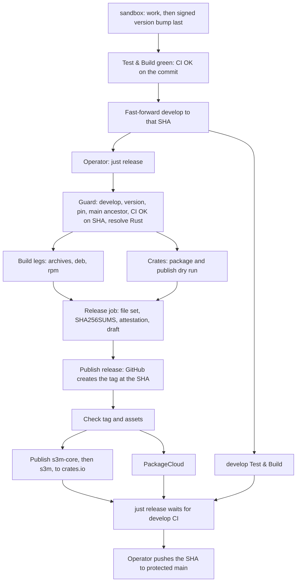

# Releasing

s3m releases with one command, `just release`, and follows one rule:

> **The commit that is released is exactly the commit CI tested, and everything
> published is built from it in one workflow run.**

The whole release is one workflow file, [`release.yml`](workflows/release.yml), a
few small [local actions](actions) and a short `release` recipe in the
[`.justfile`](../.justfile). This flow ports the one used by `cron-when`, adapted
for a Cargo workspace with two published crates (`s3m-core` and `s3m`) and
PackageCloud deployment.

- [Release contract](#release-contract)
- [Daily release](#daily-release)
- [When something fails](#when-something-fails)
- [What a release publishes](#what-a-release-publishes)
- [Settings](#settings)
- [First release on this flow](#first-release-on-this-flow)
- [Verifying a release](#verifying-a-release)

## Release contract

1. **Exact commit.** The release builds the commit `develop` points at, and the guard
   refuses it unless the `CI OK` check succeeded on that exact SHA.
2. **Tag last.** The `X.Y.Z` tag is created by publishing the GitHub release, after every
   build succeeded. There is never a tag to delete or move, and pushing a tag starts
   nothing.
3. **Versions only go up.** The version must be untagged and above the latest release.
4. **One version, two crates.** `s3m` and `s3m-core` share the workspace version and `s3m`
   pins `s3m-core` to it. The guard refuses a release where either differs.
5. **One compiler.** The guard resolves Rust `stable` to an exact version once; every Rust
   job of the run, PackageCloud included, installs that version, and the release notes end
   with `Built with Rust X.Y.Z`.
6. **Not atomic.** The release publishes to several places (GitHub, crates.io,
   PackageCloud). Each step is safe to repeat, which is what makes a failure recoverable;
   see [When something fails](#when-something-fails).

## Daily release

Work, including dependency updates, lands on `sandbox`.

1. As the last commit of the work, bump the version and update `CHANGELOG.md`:

   ```sh
   cargo set-version 0.22.0    # or --bump patch / minor / major
   ```

   Use a subject such as `0.22.0 🧹` or `bump version to X.Y.Z`. Commits must be signed.
2. When **Test & Build** is green on `sandbox`, fast-forward `develop` to that same commit
   and push. `CI OK` is attached to the commit, so the run that passed on `sandbox`
   already satisfies the guard.
3. Run `just release`. It starts the Release workflow on `develop`, follows it, waits for
   `develop`'s own Test & Build run, then moves `main` to the released commit.

Keep `develop` fast-forward only. If you squash or rebase `sandbox` after its CI passed,
the commit changes and CI has to run again.



## When something fails

Fix the cause and use **Re-run failed jobs** on the run. Every step is safe to repeat:
finished jobs are not run again, the Rust version stays the one the guard resolved, a draft
release left by a failed run is replaced, an already published release is kept (and
re-checked), and a crate version crates.io already has is skipped.

- **Before the tag exists** nothing is public. Re-run, or fix the code on `sandbox`, get
  CI green, advance `develop` and run `just release` again.
- **After the tag exists** the release is public. Later jobs (the check of the published
  release, crates.io, PackageCloud) are fixed by re-running.
- **crates.io after the tag:** if `s3m-core` was published and `s3m` was not, re-run the
  `Publish to crates.io` job; the already published crate is skipped.
- **PackageCloud** keeps `continue-on-error: true`, so an outage leaves the run green.
  Open the job's log after each release to see that the packages were pushed.
- **If `just release` stopped before moving `main`**, push it yourself once `develop`'s
  Test & Build is done: `git push origin <released-sha>:refs/heads/main`.
- **The guard refuses** when the version is already tagged, below the latest release, when
  `s3m-core` pin differs, when `develop` does not contain `main`, or when `CI OK` has not
  passed on the commit.

## What a release publishes

For version `X.Y.Z`, the GitHub release carries:

- `s3m-X.Y.Z-x86_64-unknown-linux-musl.tar.gz`, `s3m-X.Y.Z-aarch64-unknown-linux-musl.tar.gz`
  and `s3m-X.Y.Z-x86_64-apple-darwin.tar.gz`
- `s3m-X.Y.Z-x86_64-pc-windows-msvc.zip`
- `s3m_X.Y.Z-1_amd64.deb`, `s3m_X.Y.Z-1_arm64.deb`, `s3m-X.Y.Z-1.x86_64.rpm` and
  `s3m-X.Y.Z-1.aarch64.rpm`
- `s3m-X.Y.Z.crate` and `s3m-core-X.Y.Z.crate`, the packages sent to crates.io
- `SHA256SUMS` for all of them, plus a build-provenance attestation for every file

## Settings

- **Secrets**: `CRATES_TOKEN` (crates.io; publishes both crates), `PACKAGECLOUD_TOKEN`
  and `CODECOV_TOKEN`.
- **`main`**: protected, requires the **`CI OK`** check, signed commits and linear history,
  no force pushes or deletions.
- **`develop`**: keep fast-forward only.
- **A tag ruleset** letting `X.Y.Z` tags be created but never moved or deleted:

  ```sh
  gh api -X POST repos/s3m/s3m/rulesets --input - <<'JSON'
  {
    "name": "Release tags",
    "target": "tag",
    "enforcement": "active",
    "conditions": { "ref_name": { "include": ["refs/tags/[0-9]*.[0-9]*.[0-9]*"], "exclude": [] } },
    "rules": [ { "type": "update" }, { "type": "deletion" }, { "type": "non_fast_forward" } ],
    "bypass_actors": []
  }
  JSON
  ```

## First release on this flow

- [ ] **`release.yml` is on `main`.** GitHub only dispatches a workflow whose file exists
      on the default branch. Fast-forward `main` to the first green commit containing it
      (`git push origin <sha>:refs/heads/main`), then run `just release`.
- [ ] `CI OK` exists as a check on a `sandbox` commit.
- [ ] The required checks of `main` are `CI OK`.
- [ ] The secrets exist, and commits are signed and show **Verified** on GitHub.
- [ ] Bump the version on `sandbox`, wait for Test & Build, fast-forward `develop`, run
      `just release`.

## Verifying a release

```sh
sha256sum --check --ignore-missing SHA256SUMS
gh attestation verify <file> --repo s3m/s3m --signer-workflow s3m/s3m/.github/workflows/release.yml
```
